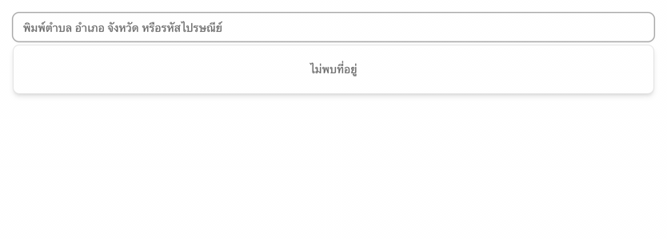

# react-thaizip

[](https://www.npmjs.com/package/react-thaizip)
[](https://github.com/naay99999/react-thai-zip/blob/main/LICENSE)

A CLI that adds ready-to-use Thai address components to your React project, shadcn/ui-style — powered by [`thaizip`](https://www.npmjs.com/package/thaizip).

📚 **[Documentation and live demos](https://react-thai-zip.vercel.app)** · Using a coding agent? See the [AI usage guide](https://react-thai-zip.vercel.app/en/docs/guides/using-with-ai) or [`llms.txt`](https://react-thai-zip.vercel.app/llms.txt)



## Quick start

> Requires a React project with Tailwind CSS (v3 or v4).

```bash
npx react-thaizip init
npx react-thaizip add autocomplete
```

```tsx
import { ThaiAddressAutocomplete } from '@/components/thai-address-autocomplete'

<ThaiAddressAutocomplete name="address" onValueChange={(address) => console.log(address)} />
```

The component is copied into your codebase, so you own it and can edit it freely.

## Components

| Name | Component | What it does |
|---|---|---|
| `autocomplete` | `ThaiAddressAutocomplete` | Search-as-you-type address input |
| `cascade-select` | `ThaiAddressCascadeSelect` | Province → district → subdistrict dropdowns |
| `address-form` | `ThaiAddressForm` | House number, moo, soi, street + cascade |
| `address-display` | `ThaiAddressDisplay` | Read-only formatted address |
| `address-form-field` | `ThaiAddressFormField` | react-hook-form field |

```bash
npx react-thaizip add                  # pick interactively
npx react-thaizip add cascade-select   # or name one (or several)
```

Works with plain Tailwind or your existing shadcn/ui setup (Base UI, Radix, or React Aria) — detected automatically. Thai and English labels built in.

## Learn more

- [Getting started](https://react-thai-zip.vercel.app/en/docs/getting-started)
- [Components](https://react-thai-zip.vercel.app/en/docs/components/autocomplete) — props and examples
- [Customization](https://react-thai-zip.vercel.app/en/docs/guides/customization) · [Forms](https://react-thai-zip.vercel.app/en/docs/guides/forms)
- [CLI reference](https://react-thai-zip.vercel.app/en/docs/reference/cli)

## License

MIT
